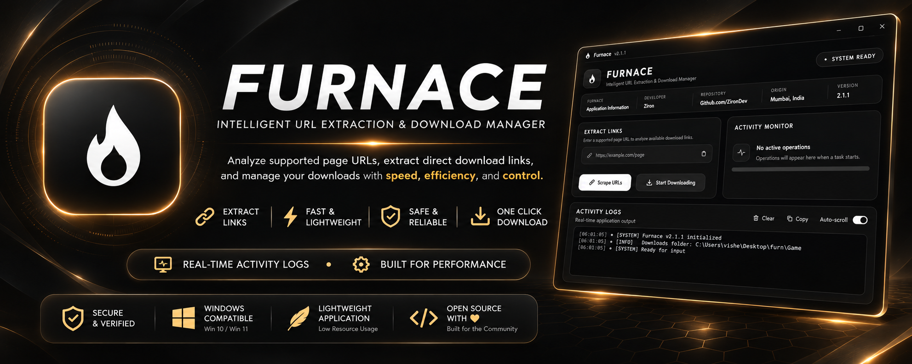
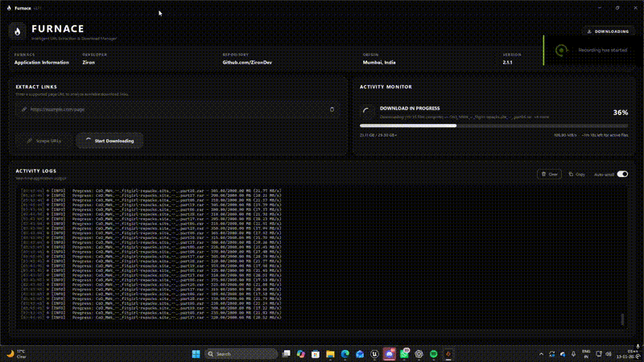

<p align="center">
  
</p>

<h1 align="center">FURNACE</h1>

<p align="center">
  <strong>Intelligent URL Extraction & Download Manager</strong><br>
  A streamlined desktop application for extracting supported download links and managing multi-file downloads from one place.
</p>

<p align="center">
  
  
  
  
</p>

---

## Overview

**Furnace** brings link extraction, batch downloading, transfer monitoring, and detailed logs into a single modern desktop interface. It is built with **Python**, **PySide6**, and **Playwright**, with a monochrome design and a separate worker-based backend to keep the UI responsive.

The current implementation is designed around **FitGirl repack pages, supported paste pages, and FuckingFast download links**. It is not a universal downloader for every website.

> **Precompiled release only:** This repository distributes the Windows executable through **GitHub Releases**. The application source code is not published here. No Python installation or manual compilation is required to use a release.

## Features

### Link extraction

- **One-click URL scraping** — paste a supported page URL and start extraction from the interface.
- **Automated link resolution** — resolves supported FuckingFast file pages into direct download URLs using headless Chromium and Playwright.
- **Batch extraction** — processes up to **3 links concurrently** using reusable browser tabs.
- **Retry handling** — retries failed link-resolution attempts and responds to timeouts or rate limits with readable status messages.
- **Multi-part file ordering** — removes duplicate links and naturally sorts archive parts into the correct sequence.
- **Repack and update detection** — identifies main archive files, optional/selective `.bin` files, and update links from supported pages.
- **Paste-page support** — opens supported JavaScript-rendered paste pages to discover links.
- **Saved extraction results** — stores resolved links in `data/final_urls.txt` for the next download operation.

### Download manager

- **Parallel downloads** — downloads up to **5 files simultaneously**.
- **Real-time progress tracking** — displays overall progress, completed file count, transferred data, and active filenames.
- **Speed and ETA** — estimates download speed and remaining time for active files when the server provides enough size information.
- **Automatic file naming** — derives names from link fragments, response headers, or URLs and sanitizes unsupported filename characters.
- **Skip completed files** — avoids re-downloading an existing file when its size matches the server-reported file size.
- **Download summary** — reports successful and failed files at the end of an operation.
- **Dedicated download folder** — saves files to `Game/`.

### Desktop experience

- **Black, gray, and white interface** with custom vector icons, smooth transitions, and a frameless window.
- **Adaptive dashboard layout** with dedicated link-extraction, activity-monitor, and logging sections.
- **Live activity monitor** with animated progress and task status.
- **Detailed, timestamped logs** with severity indicators for tasks, successes, warnings, and errors.
- **Copy and clear logs** controls, plus an **auto-scroll toggle**.
- **Toast notifications** for important events and operation results.
- **Input validation** and clear messages for invalid URLs.
- **Safe-exit confirmation** when closing the app during an active operation.
- **Reduced-motion support** through system settings or the `FURNACE_REDUCE_MOTION=1` environment variable.

## Download & installation

**Furnace is distributed as a precompiled Windows executable.** There is no source download, Python setup, or local build process required.

1. Open the [**latest GitHub release**](../../releases/latest) or select **Releases** on this repository.
2. Download the **Windows `.exe`** file provided in the release assets.
3. If the release is packaged as a `.zip`, extract it first.
4. Run the executable to launch Furnace.

**Supported platform:** Windows 10 and Windows 11. An internet connection is required for link extraction and downloads. Check the release notes for any version-specific setup requirements.

## How to use

1. **Enter a URL** from a supported source in the extraction field.
2. Click **Scrape URLs** and follow the extraction progress in the activity monitor.
3. Once the links are resolved, click **Start Downloading**.
4. Track progress, speed, and file status in the dashboard or activity logs.
5. Find completed files inside the **`Game/`** directory.

Furnace saves extracted direct URLs to **`data/final_urls.txt`**. You can start downloading the previously saved links without scraping again, although time-limited links may expire.

## Keyboard shortcuts

| Shortcut | Action |
| :-- | :-- |
| `Ctrl + L` | Focus the URL input |
| `Ctrl + Enter` | Start URL extraction |
| `Ctrl + Shift + C` | Copy all activity logs |
| `Ctrl + Shift + L` | Clear activity logs |

## Repository layout

```text
Furnace/
├── assets/
│   ├── banner.png       # Banner displayed at the top of this README
│   └── demo.gif         # Application demo displayed at the bottom
└── README.md
```

**Compiled application builds are available in [Releases](../../releases)** rather than in a `src/` folder or public source files.

## Tech stack

| Component | Technology |
| :-- | :-- |
| Desktop interface | Python, PySide6 / Qt |
| Browser automation | Playwright, Chromium, Playwright Stealth |
| Page parsing | Requests, Beautiful Soup |
| Concurrent operations | Asyncio, threads, `ThreadPoolExecutor` |
| Download streaming | Requests |
| UI rendering | Qt / QPainter |

## Notes

- **Supported sources are limited** to the page and file hosts handled by the current scraper.
- **Link resolution has retries**, but interrupted file transfers do **not** currently have pause/resume support.
- Some links may stop working because of host rate limits, network failures, or expiration.
- `Game/` and `data/final_urls.txt` are runtime files/folders used by the application, **not source files included in this repository**.
- Only download files you have the right to access. Furnace is not affiliated with third-party content or hosting services.

---

## Demo

<p align="center">
  
</p>
